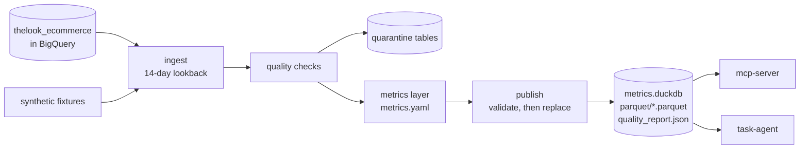

# data-pipeline

Imports a source, checks its quality, and publishes daily metrics under a versioned contract.



## Key numbers

| What | Number | How to check |
|---|---|---|
| Live run on 2026-11-16 | 2,858,962 rows read from six tables, 281 MB processed in BigQuery, 349 seconds | `make run` |
| Quality checks on that run | 47 of 47 pass, 0 rows quarantined | `data/output/quality_report.json` |
| Published from that run (contract v2) | 2,875 days, 2019-01-02 to 2026-11-15; 375,908 rows in `daily_metrics`, 70,485 in `daily_by_category`, 28,750 in `daily_by_distribution_center` | printed by `make run` |
| Tests | 284, all offline on synthetic fixtures | `uv run pytest -q` |
| Demo | Two runs that end with 3,321 source rows and 30 days of metrics, in about 1 second | `make demo` |
| Rows in `samples/v2` | 338 in `daily_metrics`, 30 in `daily_totals`, 120 in `daily_by_category`, 90 in `daily_by_distribution_center`, 9 in `metric_definitions`, 1 in `run_metadata` | printed by `make sample` |

The live numbers are from one run. The source regenerates its data every day, so a run on
another day reads different rows. The test, demo and sample numbers come from the synthetic
fixtures and never change.

## Quickstart

Needs [uv](https://docs.astral.sh/uv/). It installs Python 3.14 and the locked dependencies.

```sh
make demo
```

This runs the whole pipeline twice on synthetic fixtures, offline, into `data/demo/`. The
first run loads everything as of 2026-01-21. The second, as of 2026-01-31, is incremental:
it re-reads from 2026-01-07 on. Then it prints the newest daily totals:

```text
Run 3fae9493d96841abbf8c5effdebd08ec (fixtures), published 2026-11-16 05:38 UTC, quality pass
Data 2026-01-01 to 2026-01-30; rows from 2026-01-17 on may still change

| Date | Revenue | Orders | Units | Returned | AOV | Return rate | Conversion |
|---|---:|---:|---:|---:|---:|---:|---:|
| 2026-01-21 * | 1,148.34 | 8 | 19 | 3 | 143.54 | 15.8% | 65.5% |
| 2026-01-22 * | 319.37 | 3 | 6 | 4 | 106.46 | 66.7% | 52.9% |
| 2026-01-23 * | 862.45 | 7 | 16 | 0 | 123.21 | 0.0% | 62.1% |
| 2026-01-24 * | 1,192.31 | 7 | 17 | 2 | 170.33 | 11.8% | 76.7% |
| 2026-01-25 * | 312.08 | 3 | 6 | 0 | 104.03 | 0.0% | 40.0% |
| 2026-01-26 * | 677.84 | 7 | 12 | 3 | 96.83 | 25.0% | 70.6% |
| 2026-01-27 * | 1,136.96 | 5 | 17 | 0 | 227.39 | 0.0% | 70.8% |
| 2026-01-28 * | 666.49 | 4 | 7 | 0 | 166.62 | 0.0% | 46.7% |
| 2026-01-29 * | 398.49 | 5 | 6 | 0 | 79.70 | 0.0% | 54.5% |
| 2026-01-30 * | 690.70 | 4 | 8 | 0 | 172.68 | 0.0% | 41.9% |

* may still change
```

The run id and publish time differ on each run. The outputs are in `data/demo/output/`:
`metrics.duckdb`, `parquet/*.parquet` and `quality_report.json`.

For a live run, sign in once and name the Google Cloud project that pays for the queries:

```sh
gcloud auth application-default login
export GCP_PROJECT=<your-project-id>
make run
```

`make run` reads `bigquery-public-data.thelook_ecommerce` read-only, checks it, publishes
to `data/output/` (or `$DATA_OUTPUT_DIR`) and prints the latest days.

## How it works

- **Ingest:** each run reads the source as of one time and replaces a 14-day lookback
  window in one DuckDB transaction. See [docs/how-it-works.md](docs/how-it-works.md).
- **Quality:** bad rows are quarantined, never dropped. A failed critical check stops the
  run and nothing is published. See [docs/quality.md](docs/quality.md).
- **Metrics layer:** nine metrics defined in [metrics.yaml](metrics.yaml), computed over two
  SQL views in [sql/views/](sql/views/), for complete UTC days only.
- **Publish:** the outputs are validated against the JSON Schemas in
  [contract/v2/](contract/v2/), written to a temporary directory, then moved into place.
- **Contract:** the pipeline publishes v2. [docs/contract.md](docs/contract.md) states
  every table, grain, column and metric definition. Any change to them is a new version.
- **Source:** [docs/source-profile.md](docs/source-profile.md) records what the live data
  looks like and what the pipeline does about it.
- **Consumers:** [mcp-server](https://github.com/yasabbasi/mcp-server) and
  [task-agent](https://github.com/yasabbasi/task-agent) read the outputs. mcp-server tests
  against a copy of [samples/v2/](samples/v2/).

## Limitations

- **One source.** Only `thelook_ecommerce` is supported. The layout has room for more
  under `src/data_pipeline/sources/`.
- **Live runs are full refreshes.** thelook rewrites its history every day, so `make run`
  reloads everything. The incremental path is exercised on the fixtures.
- **Recent days may change.** Rows with `metric_date` on or after
  `run_metadata.restated_from` (the last 14 days) can change on later runs. The demo output
  marks them with `*`.
- **`metrics.yaml` is trusted.** The `expr` and `filter` fields go into the SQL as written.
  They are repo text, reviewed like code, and are not safe for outside input.
- **No scheduler.** Nothing runs the pipeline on a timer. A person or another tool runs it.

## Development

- `make check` runs the linters and the tests. CI runs the same command.
- `make format` fixes style and formatting.
- `make sample` rebuilds `samples/v2/` from the fixtures. A test fails when it is out of date.
- A published contract version is frozen. `contract/checksums.json` pins the SHA-256 of
  each version's schema files and `samples/checksums.json` pins its sample files. A test
  fails if they change. A change to the outputs goes in a new directory, `contract/v3/`,
  with its own checksums and `samples/v3/`.

## License

MIT, see [LICENSE](LICENSE). [DATA_LICENSE.md](DATA_LICENSE.md) covers the source data and
the clean-room note.
